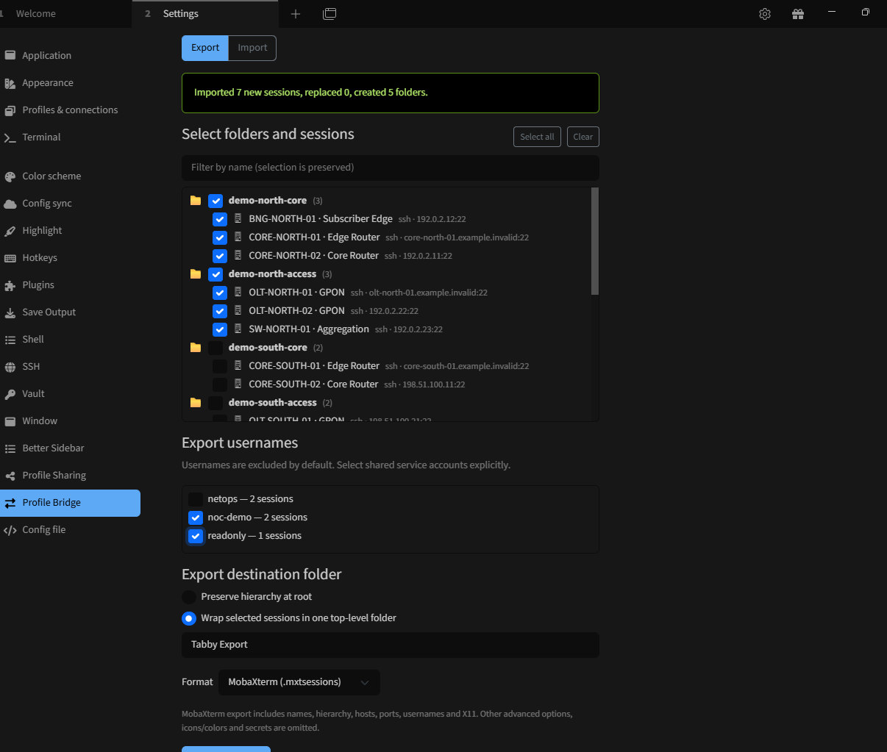
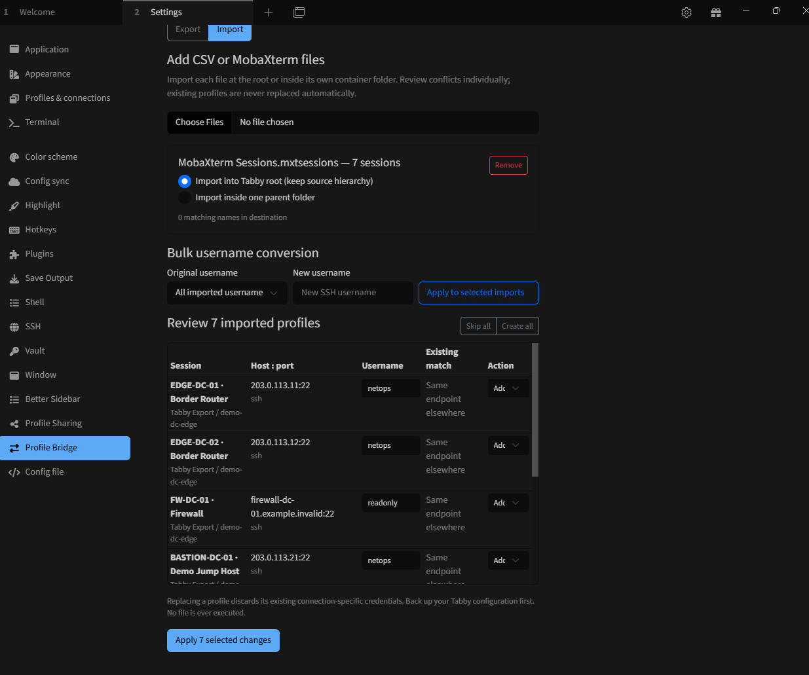

# Tabby Profile Bridge

**Your connections, across terminals.**

Import and export SSH/Telnet profiles across Tabby, CSV, and MobaXterm while preserving nested folders.

**by gugahartmann** · [Português (Brasil)](README.pt-BR.md)
## Latest release — v0.2.2

**Profile Bridge is now available as a bilingual SSH/Telnet session exchange plugin for Tabby**, with CSV and MobaXterm `.mxtsessions` support.

| | Feature | What it does |
| --- | --- | --- |
| ↔ | **Two-way exchange** | Export from Tabby and import the exported file back into Tabby or MobaXterm |
| 📁 | **Nested folder preservation** | Keep regional, location and device groups; optionally place an import/export inside a parent folder |
| 🔍 | **Review before importing** | Inspect name, IP/hostname, SSH port and username, then choose Keep, Add or Replace |
| 👤 | **Bulk username changes** | Update legacy or colleague-specific usernames before committing imported profiles |
| 🌐 | **EN / PT-BR** | Follow Tabby's language automatically; English is the fallback |
| 🔐 | **Privacy by default** | Opt in to usernames; passwords, private keys and key paths are not exported |

**Real-world check:** a Tabby → MobaXterm → Tabby exchange has been manually validated with the plugin. MobaXterm-specific advanced settings may still require manual review.

[**Download v0.2.2**](https://github.com/gugahartmann/Tabby-Profile-Bridge/releases/tag/v0.2.2) · [Release notes](docs/releases/v0.2.2.md) · [Community announcement](docs/TABBY_COMMUNITY_ANNOUNCEMENT.md)

### Screenshots

**Export — choose exactly which groups and profiles to share**

**Import — review profiles, edit usernames and decide how to handle existing connections**

## Features

- **CSV and MobaXterm** import/export (.csv and .mxtsessions).
- **Nested folders**: select entire groups or individual sessions, retaining only necessary ancestor folders.
- **Export destination**: preserve the root hierarchy or wrap selected sessions in a named parent folder.
- **Per-file import destination**: import every source file into the root or its own parent folder.
- **Conflict preview**: inspect the hostname, port, username and existing matches before choosing Keep / skip, Add as new, or Replace existing. Matching profiles are skipped by default.
- **Bulk username conversion** before import, plus individual username editing.
- **Privacy-first export**: usernames are excluded unless expressly selected. Passwords, private-key content/paths, login scripts, and proxy commands are not exported.
- **Bilingual interface**: defaults to English and follows Tabby's selected Portuguese (pt-BR or pt-PT) locale, including Automatic language detection.
- **Version attribution** at the upper-right of the plugin screen: by gugahartmann · vX.Y.Z.

## Install

When available in the npm registry, find **tabby-profile-bridge** in Tabby → Settings → Plugins. You can also obtain an installable .tgz from [GitHub Releases](https://github.com/gugahartmann/Tabby-Profile-Bridge/releases), using a plugin installation workflow supported by your Tabby version.

Open **Settings → Profile Bridge** after enabling the plugin.

## Export

1. Select the **Export** tab and tick the groups or individual SSH/Telnet sessions.
2. Opt in to the usernames that may be included in the export.
3. Select **Preserve hierarchy at root** or a named **parent folder**.
4. Choose **CSV** or **MobaXterm** and export.

## Import

1. Select the **Import** tab and add one or more CSV or MobaXterm files.
2. For **each file**, select import at the root or inside its own parent folder.
3. Review the imported sessions and warnings.
4. Optionally replace legacy usernames in bulk or edit them individually.
5. Choose **Keep / skip**, **Add as new**, or **Replace existing** for each session before applying changes.

Matching name + protocol + folder defaults to Keep / skip. The same endpoint under another name or folder is flagged without automatic replacement. Back up Tabby before replacing existing connections.

## CSV fields

| group1 | group2 | other_groups | profile | protocol | hostname | port | username |
| --- | --- | --- | --- | --- | --- | --- | --- |
| Region | City | POP / Core | CORE-01 | ssh | 192.0.2.10 | 30022 | netops |
| Region | City | POP / Access | OLT-01 | ssh | 192.0.2.11 | 22 | |

Additional columns: **auth**, **algorithms**, and **settings** (safe JSON strings). The first two folder levels have dedicated columns. Deeper paths are encoded in other_groups with escaped slash delimiters. The IPs shown above are reserved example addresses.

## MobaXterm compatibility

Supports compatible SSH/Telnet bookmarks in .mxtsessions with names, nested folders, hostname/IP, custom ports, usernames, and basic X11. Advanced MobaXterm-specific settings may be omitted and unsupported data can be reported. Verify exported files in the target MobaXterm version before production use.

## Security and limits

Processing is local. Hostnames, IPs, and opt-in usernames may still be sensitive, so inspect files before sharing. Passwords, private-key content or paths, scripts, and proxy commands are never exported. Replacing a profile discards its previous connection-specific credentials.

Import limit: **5 MB/file**, **10,000 profiles/file**, **32 folder levels**. MobaXterm may reject folder/session characters not supported by its format.

## Documentation

- [User Guide (English)](docs/USER_GUIDE.md)
- [Guia do Usuário (Português do Brasil)](docs/GUIA_USUARIO.pt-BR.md)
- [Changelog](CHANGELOG.md)

## Roadmap

Future adapters: SecureCRT, mRemoteNG and other connection managers.

MIT © 2026 gugahartmann.
